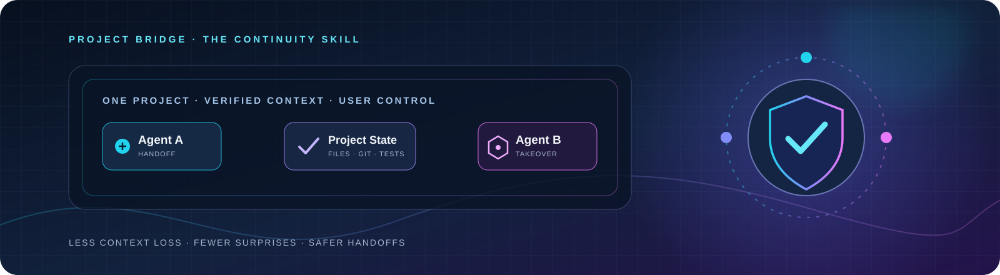
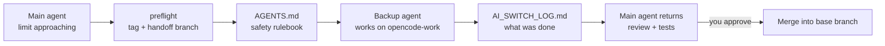

<p align="center">
  
</p>

<h1 align="center">Project Bridge</h1>

<p align="center">
  <strong>Switch AI coding agents. Keep your project intact.</strong><br />
  A portable, safety-first Agent Skill for handing off existing software projects between Claude Code and OpenCode.
</p>

<p align="center">
  <a href="LICENSE"></a>
  <a href="https://github.com/itzmoksh01/project-bridge/actions/workflows/validate.yml"></a>
  
  
  
  
  
</p>

<p align="center">
  <a href="#the-problem">The problem</a> ·
  <a href="#the-approach">The approach</a> ·
  <a href="#limit-safe-mode">Limit-safe mode</a> ·
  <a href="#quick-start">Quick start</a> ·
  <a href="#the-optional-handoff-receipt">Handoff receipt</a> ·
  <a href="#contribute">Contribute</a> ·
  <a href="#support">Support</a>
</p>

---

## The problem

You have a working project. One AI coding agent has been building it. Then you hit a usage limit, switch tools, start a fresh session, open a different clone, or return after a break.

The next agent may see the files—but it does not automatically know the decisions, unfinished work, local changes, risks, or boundaries behind them.

That gap can lead to:

- **Lost context:** completed work gets repeated and important decisions disappear.
- **Overwritten work:** an agent mistakes uncommitted changes for disposable files.
- **False continuity:** a shared folder is confused with shared chat history, logins, databases, or MCP configuration.
- **Agent collisions:** two coding agents write to the same working tree at once.
- **Secret exposure:** credentials or private project details get copied into handoff notes.

**Project Bridge turns an informal “here’s what I did” message into a deliberate, verifiable handoff process.**

## The approach

<p align="center">
  <strong>Inspect → Record → Stop → Re-check → Continue</strong>
</p>

| Stage | What Project Bridge guides the agent to do |
|---|---|
| 🔎 **Inspect** | Confirm the project root, read relevant instructions, and inspect actual Git/workspace state before editing. |
| 📤 **Prepare** | Summarize goals, constraints, completed work, changed files, tests, blockers, and unknowns. |
| 🛑 **Stop** | Confirm the previous writer has stopped and saved its work before another agent writes. |
| 📥 **Receive** | Treat the handoff as context, then verify it against the real files and Git state. |
| 🧰 **Continue** | Make the smallest user-approved change, review the diff, and report real test results. |

### Built around five safety principles

- **Repository reality beats chat memory.** Handoff notes can be stale or incomplete.
- **One writer at a time.** Never assume another agent has stopped editing.
- **No silent destruction.** Do not reset, clean, restore, stash, overwrite, or rewrite Git history as a routine handoff step.
- **Secrets stay secret.** Never copy credential values into chat, logs, screenshots, or handoff files.
- **User control comes first.** Ask before high-impact changes, external side effects, or creating a persistent handoff artifact.

## Limit-safe mode

Hit a usage limit mid-task? Chat history will not follow you to the next agent, and a rate-limited agent often cannot write a goodbye note. Limit-safe mode moves the handoff out of the chat and into **git and files**, which every agent can read.



| Piece | What it is | Why it matters |
| --- | --- | --- |
| **Checkpoint tag** | `checkpoint-before-<tool>-<date>` | Records the pre-switch commit as a reference point; it does not back up uncommitted files or automatically roll back later work |
| **Handoff branch** | `<tool>-work`, for example `opencode-work` | The backup agent never touches your base branch |
| **Shared rulebook** | [`templates/AGENTS.md`](templates/AGENTS.md) | Locks every agent reads: no secrets, no installs, no live actions, no force git |
| **Handoff log** | [`templates/AI_SWITCH_LOG.md`](templates/AI_SWITCH_LOG.md) | The next agent learns what was done, tested and left pending |

Run these from your **project** folder, not the skill folder. On Windows use Git Bash.

```bash
bash ~/.claude/skills/project-bridge/scripts/preflight.sh opencode --dry-run   # preview, changes nothing
bash ~/.claude/skills/project-bridge/scripts/preflight.sh opencode             # creates the tag and the opencode-work branch
# ... the backup agent works, one task at a time ...
bash ~/.claude/skills/project-bridge/scripts/review.sh opencode-work           # read-only review summary
```

The scripts never commit, stash, reset, clean or push, and `review.sh` prints only file names and counts, never secret values. Anything that changes your repository still needs your explicit approval.

Copy-paste prompts for each step:

| Step | Prompt |
| --- | --- |
| Backup agent reads the project (read-only) | [`prompts/01-onboard-readonly.md`](prompts/01-onboard-readonly.md) |
| One task at a time | [`prompts/02-one-task.md`](prompts/02-one-task.md) |
| End of session | [`prompts/03-handoff-entry.md`](prompts/03-handoff-entry.md) |
| Main agent reviews and merges | [`prompts/04-review-and-merge.md`](prompts/04-review-and-merge.md) |

More: [OpenCode Desktop setup](docs/OPENCODE-DESKTOP.md) · [Hinglish step-by-step guide](docs/GUIDE-HINGLISH.md) · [Release checklist](docs/RELEASE-CHECKLIST.md)

## Quick start

Project Bridge uses the open [Agent Skills format](https://agentskills.io/specification): a directory containing `SKILL.md` plus optional supporting files. It needs no installer. The optional helper scripts need only `git` and `bash` (on Windows, Git Bash).

### Option A — One install for Claude Code + OpenCode (recommended)

Current OpenCode documentation lists `~/.claude/skills` as a global compatibility source, so the same skill directory can be discovered by Claude Code and OpenCode. Verify discovery in your installed versions and check the active agent's skill permissions.

**Windows PowerShell**

```powershell
New-Item -ItemType Directory -Force "$HOME\.claude\skills" | Out-Null
git clone https://github.com/itzmoksh01/project-bridge.git "$HOME\.claude\skills\project-bridge"
```

**macOS / Linux**

```bash
mkdir -p "$HOME/.claude/skills"
git clone https://github.com/itzmoksh01/project-bridge.git "$HOME/.claude/skills/project-bridge"
```

### Option B — Install for OpenCode only

Use OpenCode's dedicated global skill directory instead:

**Windows PowerShell**

```powershell
New-Item -ItemType Directory -Force "$HOME\.config\opencode\skills" | Out-Null
git clone https://github.com/itzmoksh01/project-bridge.git "$HOME\.config\opencode\skills\project-bridge"
```

**macOS / Linux**

```bash
mkdir -p "$HOME/.config/opencode/skills"
git clone https://github.com/itzmoksh01/project-bridge.git "$HOME/.config/opencode/skills/project-bridge"
```

> Choose one installation location for a given OpenCode user profile. Avoid installing duplicate copies with the same skill ID unless you intentionally want the documented precedence behavior.

### Invoke the skill

| Tool | Invocation |
|---|---|
| Claude Code | `/project-bridge` |
| OpenCode | Ask the agent: "Use the project-bridge skill to ..." (it loads the skill with OpenCode's native `skill` tool) |

Example request:

> Prepare a safe handoff of this existing project to another coding agent. Start with a read-only audit. Do not modify files or create a handoff file unless I approve it.

If the skill is not visible, verify the folder name is exactly `project-bridge`, the file is `SKILL.md`, and the application's skill permissions allow loading it. Check the current host documentation for reload/restart behavior.

### Update an existing clone

Run this from PowerShell or a terminal:

```powershell
git -C "$HOME\.claude\skills\project-bridge" pull --ff-only
```

For the OpenCode-only installation, replace the path with `$HOME\.config\opencode\skills\project-bridge`. If you edited the installed skill locally, review and preserve those changes before updating.

## The optional handoff receipt

Sometimes a human-readable note is enough. Sometimes a structured file makes repeated handoffs easier to parse. Project Bridge includes an optional JSON **Portable Handoff Receipt**:

- [`templates/HANDOFF.md`](templates/HANDOFF.md) — human-readable handoff template.
- [`templates/HANDOFF-RECEIPT.schema.json`](templates/HANDOFF-RECEIPT.schema.json) — JSON Schema, Draft 2020-12.
- [`templates/HANDOFF-RECEIPT.example.json`](templates/HANDOFF-RECEIPT.example.json) — synthetic example.
- [`docs/PORTABLE-HANDOFF-RECEIPT.md`](docs/PORTABLE-HANDOFF-RECEIPT.md) — privacy and workflow rules.

**It is opt-in.** The agent must ask before creating a receipt, confirm where it should be saved, and never silently add it to the project or Git history. The receipt contains no credential fields by design. Avoid absolute paths, private URLs, customer data, and unnecessary proprietary details.

A receipt is context—not proof. The receiving agent must independently inspect the actual workspace and report discrepancies.

## What is shared—and what is not?

| State | Same physical working directory | Different clone / machine |
|---|---|---|
| Saved source files | Normally visible after writes finish | Not automatically shared |
| Uncommitted changes | Present in the same working tree | Stay in the original clone/worktree |
| Git commits and branches | Shared through the same repository metadata | Need an explicit Git transfer workflow |
| Chat history and agent memory | Not automatically shared | Not automatically shared |
| Provider login, OAuth, browser session | Not guaranteed | Not guaranteed |
| MCP settings, extensions, global tools | May be app-, user-, or machine-specific | Not automatically shared |
| Local database files | Only if both tools use the same actual path and compatible runtime | Not automatically shared |
| Remote services | Only if each tool is independently configured and authorized | Same rule |

## Safety model and limitations

Project Bridge is an instruction skill—not a sandbox, permission system, backup utility, synchronization engine, or guarantee against regressions. Host-agent permissions still govern what tools and commands can run. Users should keep backups, review proposed actions and diffs, run relevant tests, and explicitly approve risky operations.

The default workflow is conservative:

| Action | Default |
|---|---|
| Read project instructions and inspect Git metadata | Allowed for a requested audit |
| Edit project files | Only for a concrete user-requested task |
| Create a persistent handoff note or JSON receipt | Explicit user approval required |
| Change secrets, authentication, databases, deployment, infrastructure, or dependency versions | Explain impact and ask first |
| Commit, push, merge, rebase, reset, clean, stash, or discard changes | Never assumed as part of a handoff; obtain approval for the exact operation |
| Publish content or trigger production/external actions | Explicit authorization required |

## Compatibility status

The first release focuses on two platforms. **Documentation-based compatibility is not the same as a successful runtime test.** This repository does not claim a platform/version has passed hands-on tests until a maintainer records the result in [`docs/MANUAL-TEST-PLAN.md`](docs/MANUAL-TEST-PLAN.md).

| Platform | Documented skill discovery path | Status in this repository |
|---|---|---|
| Claude Code | `~/.claude/skills/project-bridge/SKILL.md` | Initial target; runtime test pending |
| OpenCode | `~/.config/opencode/skills/project-bridge/SKILL.md`; also documents `~/.claude/skills` compatibility | Initial target; runtime test pending |
| Other tools | Follow each tool's own Agent Skills implementation | Not in initial compatibility scope |

Official platform documentation:

- [Agent Skills specification](https://agentskills.io/specification)
- [Claude Code skills](https://code.claude.com/docs/en/skills)
- [OpenCode skills](https://opencode.ai/docs/skills)

## Validate locally

Python 3 is required only for the package validation script; it is not required to use the skill.

```bash
python scripts/validate_skill.py
bash scripts/test_scripts.sh
```

The validator checks package structure, naming/frontmatter basics, referenced files, version consistency, and the optional receipt JSON files. `test_scripts.sh` exercises the helper scripts in a throw-away git repository. It does not prove behavioral safety or runtime compatibility. Use the manual test plan with a disposable test repository before claiming that an agent/version is tested.

## Contribute

Project Bridge should become a community-maintained tool shaped by reproducible experience—not an untested prompt dump.

Good contributions include:

- Reproducible handoff failures and safe fixes.
- Claude Code and OpenCode test results with exact app versions and operating systems.
- Better support for Git worktrees, monorepos, remote development, and teams.
- Improvements to the optional receipt schema that preserve privacy and backward compatibility.
- Clearer docs, translations, accessibility improvements, and adversarial test cases.

Read [`CONTRIBUTING.md`](CONTRIBUTING.md) before opening a pull request. Do not publish credentials, private source code, customer information, personal data, or unredacted logs.

## Security

Do not post exposed credentials or sensitive vulnerability details in public issues. See [`SECURITY.md`](SECURITY.md) for responsible reporting guidance. If a real credential is committed, rotate/revoke it immediately; deleting it from the latest commit does not erase it from Git history.

## Support

Need help, found a reproducible problem, or want to suggest an improvement?

- Read [SUPPORT.md](SUPPORT.md) for the right support channel and the information to include.
- Use the [bug report](https://github.com/itzmoksh01/project-bridge/issues/new?template=bug_report.yml) or [feature request](https://github.com/itzmoksh01/project-bridge/issues/new?template=feature_request.yml) form.
- For suspected vulnerabilities, follow [SECURITY.md](SECURITY.md) instead of opening a public issue.

Please redact secrets, personal data, private source code, and customer information from every report.

## License

Project Bridge is released under the [MIT License](LICENSE).

---

<p align="center">
  <strong>Keep the code. Keep the context. Keep control.</strong><br />
  <sub>Built for developers who move between AI coding agents.</sub>
</p>
